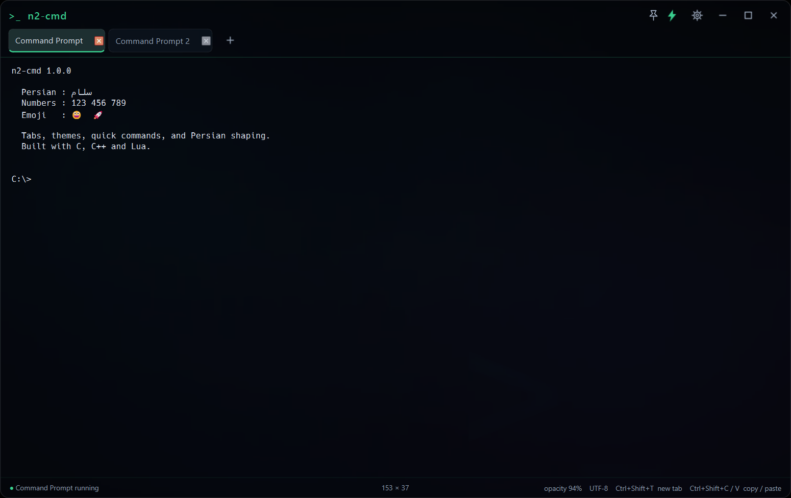
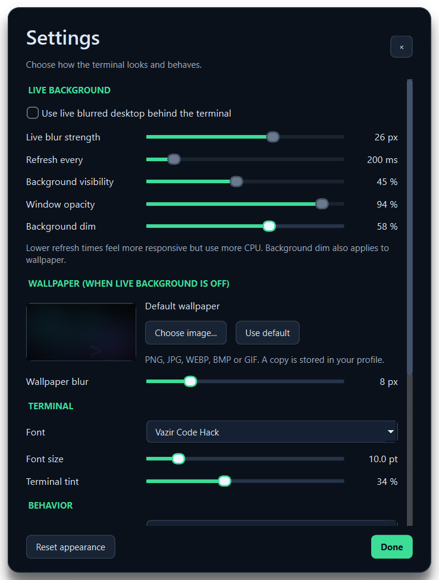
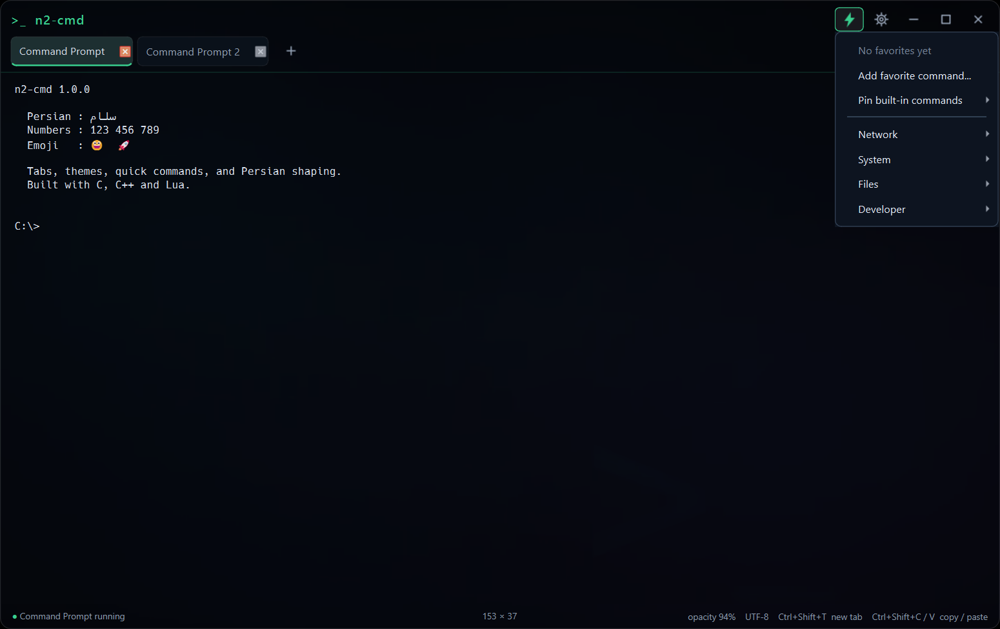

# n2-cmd

A native Windows terminal with Persian and mixed-direction text support,
customizable appearance, multiple shells, and a built-in quick-command catalog.

The application uses **C, C++ and Lua**: Qt 6 Widgets for the interface, Win32
ConPTY for shell sessions, libvterm for terminal parsing, and Lua for defaults
and command definitions. It does not require Python at runtime.

## Features

- Tabs with shell selection, rename/reset name, restart, and close-other-tabs.
- Persian shaping, mixed right-to-left/left-to-right text, selection, clipboard,
  terminal input, and IME support.
- Image backgrounds, opacity, dim, blur, tint, font/size selection, copy on
  selection, five accent colors, scrollback settings, and saved window geometry.
- 28 quick commands in Network, System, Files, and Developer categories,
  with shell-specific command text.
- Pin/unpin built-ins and add/run/remove custom favorites, saved as UTF-8.
- Custom tab names that survive shell title updates and UTF-8 output export.
- Native CMD, optional Clink-enhanced CMD, Windows PowerShell, PowerShell 7,
  Git Bash, and installed WSL distributions.

The defaults retain Vazir Code Hack at 10 pt and the Mint accent. The complete
option ranges and all 28 command names are listed in [FEATURES.md](docs/FEATURES.md).
Optional commands such as `python --version` inspect an installed tool; they do
not make that tool an application dependency.

## Screenshots







## Install on Windows

Download `n2-cmd-1.0.0-windows-x64-setup.exe` from GitHub Releases and run it.
The installer uses a per-user installation under `%LOCALAPPDATA%\Programs\n2-cmd`,
creates a Start Menu entry and optional desktop shortcut, and registers an
uninstaller. Administrator rights are not required.

Windows 10 version 1809 or later is required for ConPTY; Windows 11 is supported.

## Uninstall

Use **Settings > Apps > Installed apps > n2-cmd > Uninstall**, or open
**Start Menu > n2-cmd > Uninstall n2-cmd**. The uninstaller removes the program
files and shortcuts. Settings under `%LOCALAPPDATA%\n2-cmd` are left in place.

## Run a portable release

Extract the Windows x64 release archive into a writable folder and run
`n2-cmd.exe`. Keep the DLLs, plugin folders and license files beside it.
The package includes the application-local MSVC runtime and required Qt DLLs.

```powershell
.\n2-cmd.exe
.\n2-cmd.exe --profile powershell
.\n2-cmd.exe --profile "wsl:Ubuntu-22.04"
.\n2-cmd.exe --cwd C:\Projects --data-dir C:\Profiles\n2-cmd
```

Profiles appear only when their shell is installed. Enhanced CMD also needs an
optional Clink installation in `runtime\clink`, `clink`, or `PATH`; Clink is not
bundled with the standard release. Installing a shell is separate from installing
n2-cmd. Some quick commands depend on tools that may not be installed.

## Build and test

Install Visual Studio 2022 with **Desktop development with C++**, the Windows
SDK, and CMake 3.24 or newer. Install the **Qt 6.8.3 MSVC 2022 x64** SDK with the
**Qt Image Formats** module. The Qt installation path should contain `bin`,
`plugins`, and `lib\cmake\Qt6`. Lua 5.4.6 and libvterm 0.3.3 sources are vendored.

From the repository root, in Windows PowerShell 5.1 or PowerShell 7:

```powershell
.\scripts\Build.ps1 -QtRoot C:\Qt\6.8.3\msvc2022_64 -Test
```

Alternatively set `QT_ROOT_DIR` to that SDK directory. A sibling
`tools\Qt\6.8.3\msvc2022_64` installation is also detected. The default Release
output is `build\native\Release\n2-cmd.exe`.

The native CTest suite covers settings, the command catalog, terminal behavior,
UI interactions, and real ConPTY sessions. It uses temporary settings and does
not touch the regular user profile. Tests do not run network or system quick
commands.

```powershell
# Re-run tests after a successful build; Qt DLLs must be on PATH.
$env:PATH = 'C:\Qt\6.8.3\msvc2022_64\bin;' + $env:PATH
ctest --test-dir build\native -C Release --output-on-failure

# Optional read-only shell-discovery diagnostic.
.\build\native\Release\settings_tests.exe --profiles
```

The GitHub Actions workflow builds, tests, packages and uploads artifacts on
Windows. Its Qt setup action may use Python to obtain the SDK on the build
runner. The application itself does not use Python at runtime.

## Package a release

After a successful Release build and test run:

```powershell
.\scripts\Package.ps1 -QtRoot C:\Qt\6.8.3\msvc2022_64
```

Packaging creates a fresh versioned folder and ZIP in `dist`, and updates
`dist\current` as a junction to that verified release. The desktop and Start Menu
`CMD (Persian)` shortcuts use `dist\current\n2-cmd.exe`, so rebuilding does not
break them. Packaging installs the CMake target, deploys dynamically linked Qt
libraries, adds the Windows/JPEG/WebP/GIF/icon plugins, and includes the MSVC
runtime and license notices. The
package is checked for unexpected Qt libraries, development files, user settings,
and undeclared runtime files. A SHA-256 manifest covers every packaged file;
a separate SHA-256 file covers the archive. Existing output is never overwritten.

An isolated runtime check verifies that the packaged program starts and reads
PNG, JPEG, WebP, BMP and GIF formats using its own Qt deployment.

To build the executable installer after packaging, install Inno Setup 6 and run:

```powershell
& "$env:LOCALAPPDATA\Programs\Inno Setup 6\ISCC.exe" .\installer\n2-cmd.iss
```

The installer is written to `dist\n2-cmd-1.0.0-windows-x64-setup.exe`.

To inspect an extracted package again:

```powershell
.\scripts\Inspect-Package.ps1 -PackageDirectory .\dist\n2-cmd-1.0.0-windows-x64-<stamp>
```

## Settings and Lua

By default, settings live in `%LOCALAPPDATA%\n2-cmd\n2-cmd\settings.json`.
Use `--data-dir` or the `N2_CMD_DATA_DIR` environment variable to choose another
profile. Saves replace UTF-8 JSON atomically. The source and release archive
contain no personal settings, command favorites, history, or wallpaper imports.

The application embeds `config/defaults.lua` and `config/quick_commands.lua`.
The installed copies document those defaults; changing them requires rebuilding.
For initial profile preferences, create `preferences.lua` in the data directory:

```lua
return {
    font_family = "Vazir Code Hack",
    font_size = 10,
    accent = "#3ddc97",
    default_shell = "native",
    pinned_commands = { "git-status", "cwd" },
    favorite_commands = {
        { name = "Short status", command = "git status --short" },
    },
}
```

Load order is embedded defaults, optional Lua preferences, then saved JSON.
Saved choices take precedence over initial preferences. Lua configuration returns
a table and has bounded execution without filesystem/process libraries.
Favorites allow 60 entries, names up to 64 Unicode characters, and commands up
to 2,000 Unicode characters. See [FEATURES.md](docs/FEATURES.md) for details.

## Keyboard and mouse

| Action | Shortcut |
| --- | --- |
| New tab | Ctrl+Shift+T |
| Close tab | Ctrl+Shift+W |
| Next/previous tab | Ctrl+Tab / Ctrl+Shift+Tab |
| Rename tab | F2 or double-click the tab |
| Quick commands | Ctrl+Shift+P |
| Save output | Ctrl+Shift+S |
| Copy/paste | Ctrl+Shift+C / Ctrl+Shift+V |
| New line in Codex and other TUI editors | Shift+Enter |
| Scroll back | Mouse wheel; click or drag the right scrollbar |
| Keep the window above other windows | Pin button in the header |
| Zoom | Ctrl+mouse wheel |
| Select text | Mouse drag |
| Copy, paste and tab actions | Right-click context menus |

## Source and licenses

```text
src/          C++ interface, settings, ConPTY and terminal integration
config/       Lua defaults and complete quick-command catalog
third_party/  Vendored Lua and libvterm C sources
tests/        Native settings, terminal, UI and ConPTY tests
scripts/      Build, package and integrity-check helpers
licenses/     Dependency licenses and component notices
```

The n2-cmd application source is under the [MIT License](LICENSE). Dependency
licenses and exact upstream sources are documented in [THIRD_PARTY.md](THIRD_PARTY.md).
Qt remains dynamically linked and replaceable; its LGPL/GPL license texts and
third-party notices are included in release archives.
